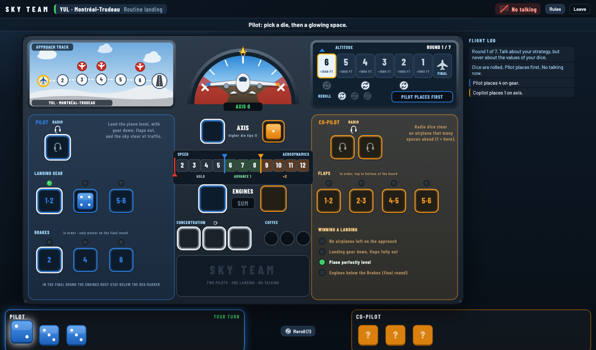

# Sky Team — online

Play the cooperative landing game **Sky Team** in the browser: one Pilot, one Co-Pilot, seven rounds to put the
plane on the runway. Share a link with a friend, or play both seats on one device.



## Features

- **The full landing rules**: Axis, Engines (Aerodynamics markers that move with Landing Gear and Flaps), Radio,
  Landing Gear, Flaps, Brakes, Concentration and Coffee, Reroll tokens, the 7-round altitude track, holding patterns,
  collisions, overshooting, and the final round.
- **All 21 scenarios** of the flight log, in four difficulty tiers (Green, Yellow, Red, Black) with the modules
  Kerosene, Intern, Wind, Real-Time, Kerosene Leak and Ice Brakes, Traffic die, turn corridors, and the six
  Special Abilities (Working Together, Synchronisation, Mastery, Control, Anticipation, Adaptation).
- **A cockpit that looks the part**: the control panel, axis dial, speed gauge, approach and altitude windows, dice
  and tokens are all drawn as SVG.
- **Pick the scenario in the lobby.** Landed scenarios are stamped on their card.
- **Local progress**: finished scenarios are stored in `progress.json` next to where you start the server. The file
  is `.gitignore`d, so it never ends up in the repo.
- **Two ways to play**: two browsers on a table link (each pilot only sees their own dice; the server holds the
  state and checks every move), or *Both seats on this device* with a "pass the device" screen between turns.
- **Communication, minimal**: no chat. A speech-bubble symbol tells you when talking is allowed (before the roll,
  strategy only) and when it is silence time.

## Requirements

- [uv](https://docs.astral.sh/uv/getting-started/installation/); it installs Python and all dependencies for you.

## Quick start

```bash
git clone https://github.com/dmytro-mz/sky-team.git
cd sky-team
uv run skyteam serve
```

Open <http://localhost:8000>, click **Create a table** (or **Play on one device**), choose a scenario, sit down in
the Pilot and Co-Pilot seats, and take off. Friends on the same Wi-Fi can use the network link printed at startup.

`uv run skyteam serve --help` lists the options (host, port, `--progress` file).

## How to play

Each round both pilots secretly roll four dice, then take turns placing one die on the panel:

| Space | Who | What it does |
| --- | --- | --- |
| Axis | both, mandatory | The plane tips towards the higher die by the difference. Reaching the red ✕ spins you out. Must be level at the end. |
| Engines | both, mandatory | The total moves the Approach Track: up to blue hold, up to orange 1 space, above 2 spaces. |
| Radio | Pilot 1, Co-Pilot 2 | Removes an airplane that many spaces ahead (1 = the space you are on). |
| Landing Gear | Pilot | 1·2, 3·4, 5·6 in any order. Each one raises the blue marker. |
| Flaps | Co-Pilot | 1·2, 2·3, 4·5, 5·6 in order. Each one raises the orange marker. |
| Brakes | Pilot | 2, 4, 6 in order. In the final round the engines must stay below the red marker. |
| Concentration | both | Any die earns a Coffee (max 3), worth ±1 on a die you place. |

After round 6 the airport must be in view. Win the final round with no airplanes left, gear down, flaps out, the plane
level and the engines below the brakes. Click a die, then a glowing space; with Coffee, use the −1/+1 buttons first.
Reroll tokens let both pilots reroll any of their unplaced dice.

## A note on fidelity

The rules and scenario list follow the published game, and the artwork is drawn from scratch. A few numbers are not
available in print online, so they are reconstructed and may differ from the box: the exact airplane/traffic
positions and turn corridors on each approach track, which scenario gets which random ability cards, the dial range,
and the Intern, Wind and Kerosene numbers. They are all data in
[`src/skyteam/game/scenarios.py`](src/skyteam/game/scenarios.py) and the constants at the top of
[`engine.py`](src/skyteam/game/engine.py), so they are easy to adjust.

Sky Team is designed by Luc Rémond and published by Scorpion Masqué. This is an unofficial fan project, not
affiliated with them.

## Development

```bash
uv run pytest                      # rules and server tests
uv run python scripts/solve.py 5   # rough balance check with a perfect-information planner
```
